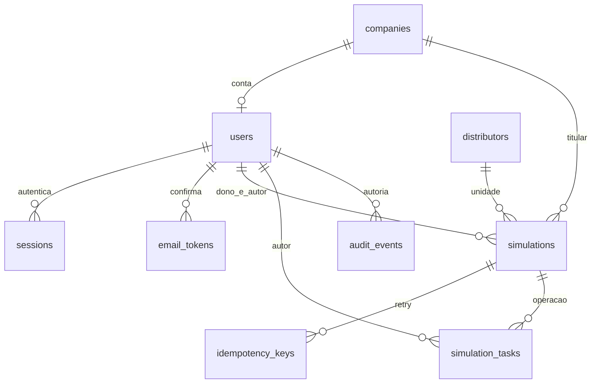

# Banco local — Fases 1 e 2

SQLAlchemy 2.0.57 e Alembic 1.20.1; SQLite local 3.50.4 verificado em 06/11/2026. A aplicação não executa `create_all`, migrações ou seed no import/startup. `alembic upgrade head` prepara explicitamente o diretório pai do arquivo configurado em DATABASE_URL. Arquivos SQLite/WAL/SHM ficam fora do Git.

## Esquema e ordem

`0001_roots`: companies → distributors → users. Empresa não aponta de volta ao usuário. Uma conta por empresa, e-mail normalizado único; papel client/admin e estado pending/active/blocked têm checks nomeados.

`0002_access_simulations`: rate_buckets, email_tokens, sessions → simulations → idempotency_keys → audit_events. Ativação e recuperação compartilham tabela com finalidade restrita, expiração e consumo único. Instantes são inteiros de segundos Unix UTC; não confundir com datas de competência da futura camada de faturas.

`0003_simulation_tasks`: metadados de operações dependentes de simulação/ator, sem payload. FKs CASCADE para simulação e RESTRICT para ator. Checks de estado/revisão/lease e índice por simulação/estado. Detalhes em [TASKS](TASKS.md).



FKs habilitadas em toda conexão; WAL e busy_timeout de dez segundos. Escritas usam `BEGIN IMMEDIATE`, antes de ler estado/cota. Leituras autenticadas também atualizam last_seen e por isso usam transação de escrita curta. É uma escolha para o piloto SQLite, sem alegar escalabilidade de produção.

Simulações guardam dono, empresa e autores separadamente. FK composta `(owner_id, company_id)` exige a empresa do dono. Empresa/catálogo/dono/autores usam RESTRICT; sessões e tokens dependentes usam CASCADE; ator da auditoria usa SET NULL. Não há exclusão de contas implementada. Faturas herdam dono/empresa da simulação e registram autor separadamente. Tarifas, regras, cálculos e tabelas comerciais entram nas fases correspondentes.

## Cota, revisões e exclusão

Duas vagas por dono: `slot=1` ou `2`, unique `(owner_id, slot)`. Todos os estados não excluídos precisam de vaga; deleted exige slot NULL. Mesmo SQL direto não pode criar a terceira vaga, trocar empresa de dono ou registrar simulação ativa sem slot.

Criação grava simulação, chave de idempotência por ator e auditoria na mesma transação. Mesma chave/dono retorna o recurso existente; trocar o dono retorna 409. Retry após exclusão retorna 404 e nunca recria o recurso. Dois pedidos distintos disputando uma vaga produzem 201 e 409; retry concorrente da mesma chave retorna o mesmo ID.

Salvar unidade exige distribuidora do catálogo, UC, titular e endereço próprio do ponto de conexão. Não copia nem altera o endereço da empresa automaticamente. Toda alteração usa expected_revision; UC/distribuidora já salvas não podem virar outra unidade dentro da mesma simulação. Autoria e valores anterior/novo ficam em auditoria estruturada.

Excluir exige confirmação/revisão, marca tombstone, incrementa revisão, libera slot e cancela tarefas queued/running atomicamente, limpando leases. Guard/finish recusam o ID excluído, inclusive com objeto ORM em cache ou executor que termina depois. Nova revisão da unidade também cancela tarefas antigas. [TASKS](TASKS.md) define confirmação estruturada em transação nova/curta, heartbeat, expiração e resultado/estado atômicos. Faturas/filhos já são removidos na transação da exclusão; coordenador/processos reais continuam nas próximas entregas da Fase 2; tombstones/auditoria ainda não têm expurgo de retenção. Não usar dados reais.

## Decimal

`DecimalType(precision, scale)` aceita Decimal/string, rejeita float, não finitos, overflow e perda de escala. SQLite usa texto de escala fixa, sem notação exponencial; PostgreSQL usa Numeric(p,s). Nenhuma agregação ou ordenação lexical é tratada como cálculo numérico. Precisões/escalas faturáveis estão definidas abaixo; não há arredondamento implícito.

Roundtrip local testado com valores de 30 dígitos e dez casas. O tipo PostgreSQL foi apenas inspecionado por compilação de dialeto; conexão, migrações e dados PostgreSQL não foram validados. Os contratos continuam exigindo Decimal como strings no JSON.

## Comandos verificados

Na raiz, depois de preparar `.venv` conforme SETUP:

```powershell
.\.venv\Scripts\python.exe -m alembic upgrade head
.\.venv\Scripts\python.exe -m alembic current
.\.venv\Scripts\python.exe -m alembic check
```

Revisão atual `0007_invoice_publications`. Upgrade limpo, upgrade preservando empresa criada em 0001, downgrade para 0001 e novo upgrade foram testados em bancos sintéticos descartáveis. Nunca usar downgrade como backup. Não executar migração concorrente com aplicação em uso. Migrações são arquivos estáticos revisados; autogenerate/check não substituem a revisão de FKs e operações. Alembic está configurado para batch nas próximas alterações SQLite, conforme [documentação](https://alembic.sqlalchemy.org/en/latest/batch.html).

O seed de SETUP foi executado duas vezes no banco local e preservou contas existentes. A suíte testa também rollback sem órfãos, restrições, FKs, seed em produção recusado e concorrência de cota/idempotência. Não há dados reais de clientes ou documentos no banco criado.

PostgreSQL, backup/restauração e transporte tipado dos dados serão preparados antes da produção, sem containers nesta entrega.

## Segunda entrega da Fase 2 — reserva sintética

`0005_invoice_admissions` adiciona metadados vinculados a tarefa, simulação e ator: hash do documento sintético, hashes de chave/pedido, bytes/páginas inteiros, versões layout/parser e tombstone de remoção. Não há bytes, nome do arquivo, texto ou resultado livre. Checks por arquivo e unicidade ator/chave complementam contagem transacional no serviço; capacidade e totais não são garantidos por SQL direto. Uma tarefa por reserva, CASCADE nos pais e RESTRICT no ator. Autor/dono são revalidados no serviço; não se admite escrita direta por clientes. Detalhes e limitações em [ADMISSION](ADMISSION.md). Exclusão lógica da simulação remove também as reservas na transação do cancelamento; não espera CASCADE de um pai que permanece como tombstone.

## Terceira entrega da Fase 2 — liderança do coordenador

`0006_coordinator_lease` cria singleton `coordinator_lease` (id=1, geração positiva, hash de token e vencimento UTC) e adiciona `invoice_admissions.coordinator_epoch` nullable. Sem vínculo com documento, conteúdo da fila ou resultado. A geração não usa FK para a geração mutável do singleton: valores antigos permanecem como metadados de recuperação. Reservas existentes ficam NULL, preservadas sem takeover automático. Aquisição/recuperação/renovação usam `BEGIN IMMEDIATE`; TASKS recusa operações de geração vencida/antiga. Nenhum coordenador é iniciado por migração ou startup. Ver [COORDINATOR](COORDINATOR.md).

Downgrade para 0005 e novo upgrade com reserva preenchida preservam o registro e TASKS, removendo a geração na volta a 0005 e restaurando-a como NULL no novo upgrade; verificadas FKs e Alembic check. Essa perda de metadados é esperada somente em descartáveis: nunca fazer downgrade com coordenador em operação. Migração local aplicada, readiness exige 0006. PostgreSQL e contenção de processos pelo SO ainda não validados.

## Quarta entrega da Fase 2 — publicação normalizada sintética

`0007_invoice_publications` adiciona `simulations.dataset_revision` positivo, com default 1 para registros existentes, e `invoice_publications`: task_id PK/FK da admissão, invoice_id único/FK da fatura, hashes do resultado e da lease de conclusão. CASCADE nos dois pais remove o vínculo; não guarda documento, resultado livre ou lease em claro. O serviço confere simulação/identidade/autoria antes de publicar; SQL direto não substitui essas regras.

Unidade e tombstone continuam em Simulation.revision/TASKS.revision; publicação/remoção avançam somente dataset_revision, evitando cancelar as demais faturas independentes já admitidas. Salvar unidade/excluir avançam ambas. Novas faturas usam invoice-v0.3 e registram a revisão do conjunto na publicação; versões anteriores mantêm o significado histórico da revisão de admissão. Não existe cálculo ou relatório antigo a liberar automaticamente.

Persistência inicial cria colunas/proveniência v1/dependências/validações/evidências/vínculo e TASKS finished juntos. Grafo removido libera orçamento e conserva tombstone da admissão; exclusão da simulação remove os dois. Consultas/autorização, Decimal, replay vinculado à lease e limites do contrato estão em [INVOICE-STORAGE](INVOICE-STORAGE.md). Toda publicação nova permanece needs_review.

Downgrade/upgrade descartável com publicação preenchida preserva fatura/filhos/tarefa, perde o vínculo e restaura dataset_revision como 1. Nunca realizar essa perda deliberada em operação. SQLite local e FKs verificados; PostgreSQL ainda não validado. Readiness atual exige 0007.

## Primeira entrega da Fase 2 — esquema faturável

As descrições abaixo são o histórico da entrega 0004. A persistência inicial sintética, consulta/remoção JSON e sincronização de valores/proveniência v1 foram implementadas depois, conforme [INVOICE-STORAGE](INVOICE-STORAGE.md). Revisão operacional e prontidão continuam pendentes.

`0004_invoices` cria, depois dos pais: invoices → invoice_measurements / invoice_market_evidence / invoice_validations → invoice_items → field_provenance → field_dependencies. Modelos em `src/ecowatt/db/invoices.py`, registrados explicitamente no metadata Alembic. Migração estática com precisões/escalas revisadas; não importa os modelos para criar tabelas.

| Tabela | Dados e integridade |
| --- | --- |
| invoices | Simulação, autor, revisão do conjunto admitido, revisão própria, contrato, hash, origem synthetic/document, parser/layout, estado/erro/cobertura, identidade observada, endereço impresso separado, ciclo/classificação/mercado, datas e totais separados |
| invoice_measurements | Registro por fatura/posto; contratação, demanda medida e faturada independentes, energia ativa/reativa, unidade reativa, FP e base de perdas nullable |
| invoice_items | Ordem, tipo fechado, rótulo mínimo, posto, quantidade/unidade, preços regulado/efetivo/base tributária, valor com sinal, segmento/vigência e agrupamento TE/TUSD |
| field_provenance | Caminho completo, versão, valor escalar normalizado, unidade/estado/origem, página/região, parser, cobertura, ator/data, motivo/hipótese/regra; correção cria outra versão |
| field_dependencies | Versões concretas de entradas de derivados/estimativas, na mesma fatura; sem autorreferência direta |
| invoice_validations | Código, caminho, pass/warning/blocking, política e valores observado/esperado/diferença opcionais |
| invoice_market_evidence | Códigos fechados de evidência por ciclo; sugestão não confirma mercado nem permite inferência por ausência parcial |

Estados de arquivo: uploaded/extracting/needs_review/ready/failed/expired, distintos dos estados da simulação e do campo. Não existe coluna para documento, imagem, texto integral ou payload livre. Falha registra código técnico. Desconhecidos são NULL, sem defaults numéricos. Cabeçalhos incompletos podem ser needs_review. Mesmo mês com hashes diferentes é permitido para futura resolução de complemento/refaturamento; unique(simulation_id, source_hash) impede duplicação física por hash. Duplicidade lógica, capacidade e idempotência de admissão dependem do serviço futuro.

Medição e item têm unique(id, invoice_id); FKs compostas impedem vincular item/proveniência a filhos de outra fatura. Proveniência tem unique(invoice_id, field_path, version); caminhos incluem o ID do item/medição, por exemplo items.<id>.amount. Estado/proveniência ficam por campo nesta tabela; valores atuais ficam nas colunas tipadas. A futura persistência/revisão deve atualizar coluna e versão juntas, validar caminhos/valores, registrar os campos necessários e entradas de regras, impedir ciclos e edição do histórico. O esquema sozinho não garante essa sincronização nem autoriza declarar ready. Não há endpoint de fatura nesta entrega; require_invoice é consulta interna com guard de dono/admin, tombstone, revisão e vínculo à simulação.

Checks exigem parser/página para origem extraída, ator para user, hipótese para estimated, regra para derived, valor nulo para missing/unreadable/not_applicable, motivo para not_applicable e zero explícito com cobertura completa para zero_confirmed. Correções exigem ator/motivo. Região opcional guarda coordenadas/unidade/referencial, nunca recorte. Fixtures synthetic usam user com ator sintético; não fingem leitura PDF/OCR. Normalização e confirmação financeira serão aplicadas pelo futuro serviço.

| Valores | DecimalType(precisão, escala) | Motivo |
| --- | --- | --- |
| Quantidades/demandas/energia, valores observados e totais | (30, 10) | Até dez casas de origem, inclusive moeda ainda não fechada |
| Preços e memória numérica de validação | (38, 18) | Tarifas além de cinco casas e precisão da comparação |
| Fator de potência | (20, 16) | Grandeza adimensional; validação ORM entre 0 e 1 |
| Coordenadas da região | (20, 10) | Metadado técnico com referencial explícito |

Escala excedida é rejeitada, nunca truncada. Grandezas negativas/não finitas e float são recusados no ORM das medições; SQL direto não aplica toda validação de domínio. Créditos continuam negativos nos itens. JSON público futuro deve serializar Decimal como string, seguindo o contrato existente. Não somar/ordenar numericamente os textos no SQLite.

Faturas/filhos usam CASCADE deliberado; autores e distribuidora usam RESTRICT. Item→medição usa RESTRICT: remover itens antes de medições/faturas, como faz delete_simulation. Tombstone, revisão, slot, cancelamento e remoção dos filhos confirmam/desfazem juntos. Exclusão física do pai também respeita essa ordem. Dependências seguem cascatas da proveniência. Expurgo de tombstones/auditoria continua na fase de retenção.

Verificações de 09/11/2026: 95 testes aprovados, incluindo Edge e 27 casos novos. Upgrade limpo e preservando dados da Fase 1, downgrade/upgrade descartável com filhos, Alembic check, FKs sem órfãos, precisão, ausência versus zero, rollback do grafo/exclusão, autorização/admin e executor tardio após exclusão/revisão. Migração local aplicada; readiness exige 0004. PostgreSQL, parser/OCR, admissão, correção e processamento real seguem fora desta entrega.
