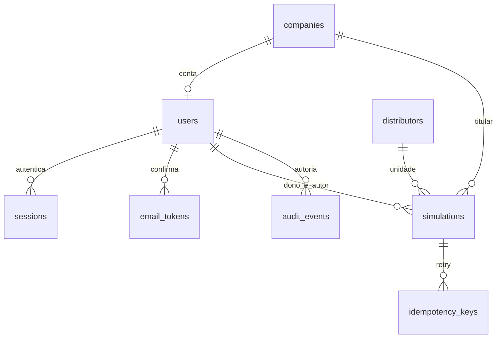

# Banco local — Fase 1

SQLAlchemy 2.0.57 e Alembic 1.20.1; SQLite local 3.50.4 verificado em 06/11/2026. A aplicação não executa `create_all`, migrações ou seed no import/startup. `alembic upgrade head` prepara explicitamente o diretório pai do arquivo configurado em DATABASE_URL. Arquivos SQLite/WAL/SHM ficam fora do Git.

## Esquema e ordem

`0001_roots`: companies → distributors → users. Empresa não aponta de volta ao usuário. Uma conta por empresa, e-mail normalizado único; papel client/admin e estado pending/active/blocked têm checks nomeados.

`0002_access_simulations`: rate_buckets, email_tokens, sessions → simulations → idempotency_keys → audit_events. Ativação e recuperação compartilham tabela com finalidade restrita, expiração e consumo único. Instantes são inteiros de segundos Unix UTC; não confundir com datas de competência da futura camada de faturas.



FKs habilitadas em toda conexão; WAL e busy_timeout de dez segundos. Escritas usam `BEGIN IMMEDIATE`, antes de ler estado/cota. Leituras autenticadas também atualizam last_seen e por isso usam transação de escrita curta. É uma escolha para o piloto SQLite, sem alegar escalabilidade de produção.

Simulações guardam dono, empresa e autores separadamente. FK composta `(owner_id, company_id)` exige a empresa do dono. Empresa/catálogo/dono/autores usam RESTRICT; sessões e tokens dependentes usam CASCADE; ator da auditoria usa SET NULL. Não há exclusão de contas implementada. Faturas, tarifas, regras, cálculos e tabelas comerciais só entram nas fases correspondentes.

## Cota, revisões e exclusão

Duas vagas por dono: `slot=1` ou `2`, unique `(owner_id, slot)`. Todos os estados não excluídos precisam de vaga; deleted exige slot NULL. Mesmo SQL direto não pode criar a terceira vaga, trocar empresa de dono ou registrar simulação ativa sem slot.

Criação grava simulação, chave de idempotência por ator e auditoria na mesma transação. Mesma chave/dono retorna o recurso existente; trocar o dono retorna 409. Retry após exclusão retorna 404 e nunca recria o recurso. Dois pedidos distintos disputando uma vaga produzem 201 e 409; retry concorrente da mesma chave retorna o mesmo ID.

Salvar unidade exige distribuidora do catálogo, UC, titular e endereço próprio do ponto de conexão. Não copia nem altera o endereço da empresa automaticamente. Toda alteração usa expected_revision; UC/distribuidora já salvas não podem virar outra unidade dentro da mesma simulação. Autoria e valores anterior/novo ficam em auditoria estruturada.

Excluir exige confirmação/revisão, marca tombstone, incrementa revisão e libera slot atomicamente. As consultas JSON/HTML e o guard `require_simulation` recusam o ID excluído. Não há worker nesta fase: a integração do guard, cancelamento e remoção dos futuros filhos será testada na Fase 2 e seguintes. Tombstones/auditoria ainda não têm expurgo de retenção; não usar dados reais.

## Decimal

`DecimalType(precision, scale)` aceita Decimal/string, rejeita float, não finitos, overflow e perda de escala. SQLite usa texto de escala fixa, sem notação exponencial; PostgreSQL usa Numeric(p,s). Nenhuma agregação ou ordenação lexical é tratada como cálculo numérico. Parâmetros finais por campo serão definidos com as tabelas faturáveis, sem uma escala universal inventada.

Roundtrip local testado com valores de 30 dígitos e dez casas. O tipo PostgreSQL foi apenas inspecionado por compilação de dialeto; conexão, migrações e dados PostgreSQL não foram validados. Os contratos continuam exigindo Decimal como strings no JSON.

## Comandos verificados

Na raiz, depois de preparar `.venv` conforme SETUP:

```powershell
.\.venv\Scripts\python.exe -m alembic upgrade head
.\.venv\Scripts\python.exe -m alembic current
.\.venv\Scripts\python.exe -m alembic check
```

Revisão atual `0002_access_simulations`. Upgrade limpo, upgrade preservando empresa criada em 0001, downgrade para 0001 e novo upgrade foram testados em bancos sintéticos descartáveis. Nunca usar downgrade como backup. Não executar migração concorrente com aplicação em uso. Migrações são arquivos estáticos revisados; autogenerate/check não substituem a revisão de FKs e operações. Alembic está configurado para batch nas próximas alterações SQLite, conforme [documentação](https://alembic.sqlalchemy.org/en/latest/batch.html).

O seed de SETUP foi executado duas vezes no banco local e preservou contas existentes. A suíte testa também rollback sem órfãos, restrições, FKs, seed em produção recusado e concorrência de cota/idempotência. Não há dados reais de clientes ou documentos no banco criado.

PostgreSQL, backup/restauração e transporte tipado dos dados serão preparados antes da produção, sem containers nesta entrega.
